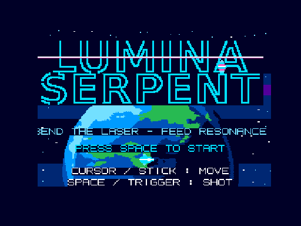

[English version](./README.md)

# luminaserpent

**LUMINA SERPENT** は **MSX2 / MSX2+ / MSX turboR** 用の
オリジナル横スクロールシューティングです。z88dk（C言語）で
開発し、起動可能な MSX-DOS ディスクイメージとして配布して
います。X68000 版と同名の作品の MSX 版で、同じゲーム
デザインを再実装したものです。



自機は **光蛇レーザー** を引き連れて飛びます。ビームは自機の
過去の位置履歴から描かれるため、移動に合わせて蛇行します。
曲がれば曲がるほど **RESONANCE** ゲージが溜まり、満タンで
強力な **PRISM BURST** が発動します。敵を倒すと装備アイテムが
現れ、**THRUST / COMET / DUAL / PRISM / ECHO / HALO** の
オリジナル装備がローテーションします。ステージの最後では、
地球を背に **ABYSS PRISM LEVIATHAN** が待ち受けます。コアは
周回する4つの破片に守られています。

背景スクロールは MSX turboR でのみ有効です。MSX2+ と
MSX2 では背景が固定になりますが、ゲーム内容は同一です。

## プレイ / ダウンロード

- [WebMSX で遊ぶ（ROM版、MSX turboR）](https://webmsx.org/?MACHINE=MSXTRJ&P=NODISK&CARTRIDGE1_URL=https://raw.githubusercontent.com/renatus-xxxx/luminaserpent/main/dist/LUMINA-LITE.ROM)
- [WebMSX で遊ぶ（DISK版、MSX turboR）](https://webmsx.org/?MACHINE=MSXTRJ&DISKA_URL=https://raw.githubusercontent.com/renatus-xxxx/luminaserpent/main/dist/LUMINA.DSK&FAST_BOOT)
- [LUMINA.DSK](dist/LUMINA.DSK) — 起動可能な 720KB ディスクイメージ（自動起動）
- [LUMINA.COM](dist/LUMINA.COM) — MSX-DOS プログラム単体

現在のビルド :`LUMINA.COM` 49,463 bytes、
MD5 `5d3200d958d4f1605f0759b79b2f1681`；
`LUMINA.DSK` MD5 `a154abe2001776b90a253a965e1667de`。

## 操作

| 入力 | 動作 |
|---|---|
| カーソルキー / ジョイスティック | 移動 |
| SPACE / トリガー | ショット（押し続けると光蛇レーザー） |
| ESC（ゲーム中） | タイトルへ戻る |
| タイトルで約5秒無入力 | アトラクトデモ |

## ビルド

```
make -f Makefile.linux        # 既定
make -f Makefile.linux dsk    # 起動可能なディスクイメージまで
```

z88dk（クラシックライブラリ、`+msx` ターゲット）が必要です。
既定のビルドは `LUMINA.COM` を生成し、`tools/make_dsk.py` が
テンプレートの MSX-DOS ディスクを使って起動可能なディスク
イメージにまとめます（データファイル `data/tpl8.dat` /
`data/gpl8.dat` / `data/gplf8.dat` / `data/logo.dat` /
`data/spark.dat` も収録）。

## 注意

- MSX2 以降（SCREEN 8、すなわち V9938 以降）が必要です。
  MSX1 には対応していません。
- MSX turboR では背景がハードウェアスクロールします。
  MSX2+ と MSX2 では背景は静止したままになります
  （ゲーム内容は同一です）。
- サウンドは PSG のみです。

## 開発について

本プロジェクトの開発（ビルド、エミュレータでの検証、ドキュメント整備）には、Meta のパーソナル AI エージェント Muse を活用しています。

パーソナルエージェントに興味があれば、こちらから Muse を試せます： https://muse.ai/join （参加後48時間以内に「設定」のコード入力で **RARMB6** を使うと、あなたと私の両方にボーナストークンが付きます）
