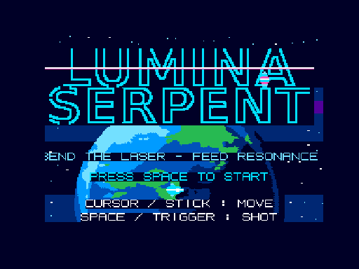

[日本語版はこちら](./README.ja.md)

# luminaserpent

**LUMINA SERPENT** is an original side-scrolling shooter for
**MSX2 / MSX2+ / MSX turboR**, written in C with z88dk and shipped
as a bootable MSX-DOS disk image. It is the MSX version of the
identically titled X68000 work, reimplementing the same game
design.



Your ship drags a **serpent laser** behind it: the beam is drawn
from a history of your past positions, so it trails and bends as
you move. The more it curves, the faster the **RESONANCE** gauge
fills — fill it completely and the beam becomes a devastating
**PRISM BURST**. Fallen enemies drop equipment that cycles
through the original set — **THRUST / COMET / DUAL / PRISM /
ECHO / HALO** — and at the end of the stage the
**ABYSS PRISM LEVIATHAN** waits in front of the Earth, its core
shielded by four orbiting shards.

## Play / Download

- [Play on WebMSX (MSX turboR)](https://webmsx.org/?MACHINE=MSXTRJ&DISKA_URL=https://raw.githubusercontent.com/renatus-xxxx/luminaserpent/main/dist/LUMINA.DSK&FAST_BOOT)
- [LUMINA.DSK](dist/LUMINA.DSK) — bootable 720 KB disk image (starts automatically)
- [LUMINA.COM](dist/LUMINA.COM) — the MSX-DOS program on its own

Current build :`LUMINA.COM` 50,263 bytes,
MD5 `e954a29b834ddadf498618c639d8afc1`.

## Controls

| input | action |
|---|---|
| Cursor keys / joystick | move |
| SPACE / trigger | shot (hold for the serpent laser) |
| ESC (in game) | back to title |
| no input on title (~5 s) | attract demo |

## Building

```
make -f Makefile.linux        # default
make -f Makefile.linux dsk    # + the bootable disk image
```

Requires z88dk (classic library, `+msx` target). The default
build defines `-DNOSCROLL` and produces `LUMINA.COM`;
`tools/make_dsk.py` packs it into the bootable disk image
using a template MSX-DOS disk, adding the Earth data files
(`data/tpl8.dat`, `data/gpl8.dat`).

## Notes

- Requires MSX2 or higher (SCREEN 8, i.e. V9938 or later).
  MSX1 is not supported.
- Sound is PSG only.
